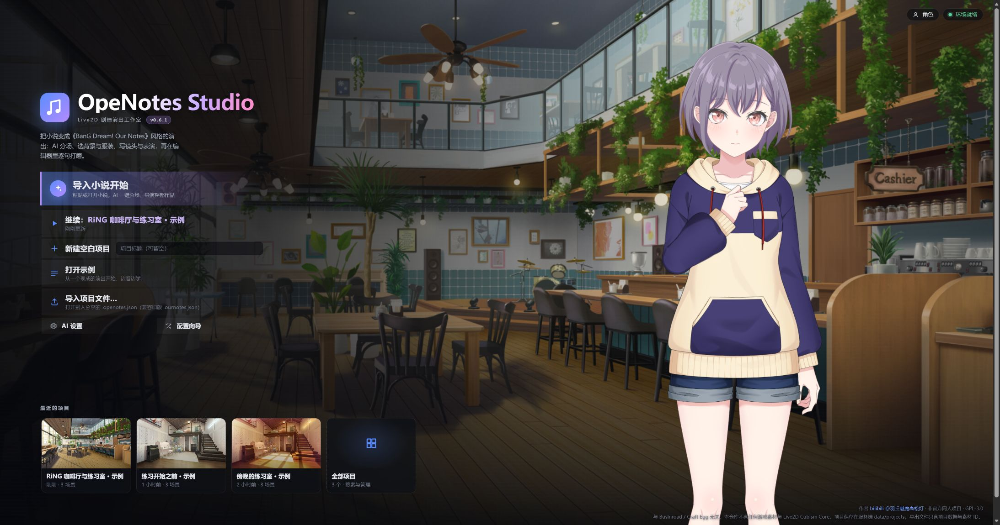
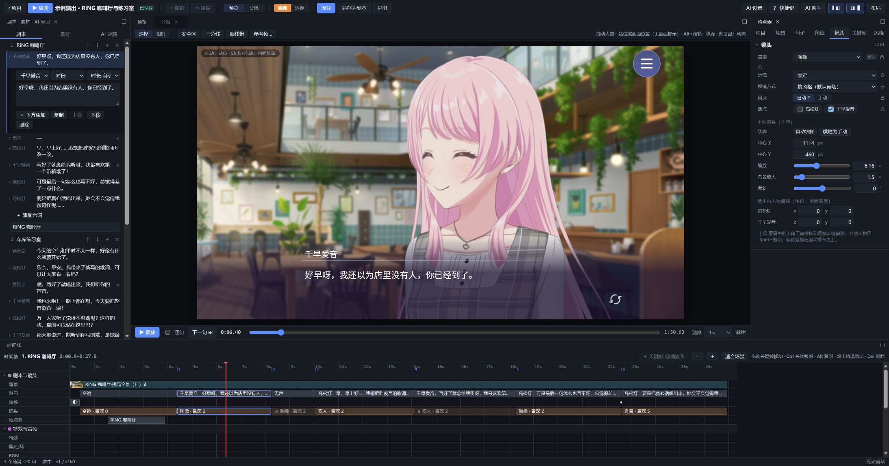
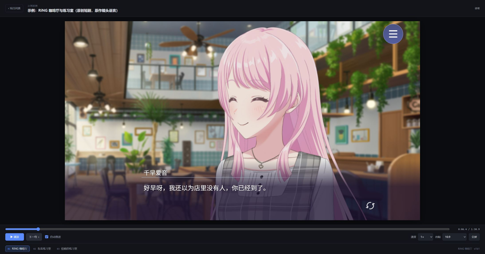
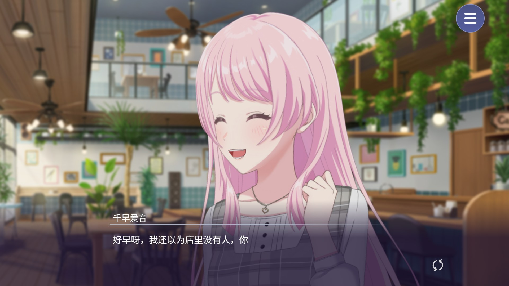

# OpeNotes Studio

**一个面向 BanG Dream! 同人创作的 Live2D 剧情编辑器。**

把写好的小说或对白，排成一场可以播放的 Live2D 演出。

OpeNotes Studio 参考《BanG Dream! Our Notes》的剧情表现形式，支持角色动作、表情、站位、分镜、运镜、景深和转场。你可以从空白项目开始慢慢制作，也可以让 AI 帮忙完成初稿，再逐句调整到自己满意。

[项目主页](https://skt0tto.github.io/OpeNotes-Studio/) · [下载](https://github.com/SKT0tto/OpeNotes-Studio/releases/latest) · [使用教程](https://github.com/SKT0tto/OpeNotes-Studio/blob/main/docs/GUIDE_ASSETS.md) · [更新记录](https://github.com/SKT0tto/OpeNotes-Studio/blob/main/CHANGELOG.md) · [问题反馈](https://github.com/SKT0tto/OpeNotes-Studio/issues)

> **v1.0.1** 已发布：AI 助手与 AI 生成合二为一，长台词按语义和情绪拆分，首页可自定义背景；1.0.1 起可用 `Update-Windows.cmd` 自动更新。[下载](https://github.com/SKT0tto/OpeNotes-Studio/releases/latest) · [更新记录](https://github.com/SKT0tto/OpeNotes-Studio/blob/main/CHANGELOG.md)

> 本项目为非官方同人项目。程序不附带游戏素材和 Live2D Cubism Core，使用前需要自行准备素材，并遵守相应的使用许可。



*从主页开始一段新故事，或继续上次的演出。图中的项目均为示例。*



*当前开发版界面。截图使用内置原创示例，发行包功能以对应版本的更新说明为准。图中角色与场景素材的权利归各自权利人所有。*

## 可以做些什么？

### 从小说开始制作

粘贴故事，或导入 `.txt`、`.md` 文件，生成场景、台词和演出初稿。支持识别章节、选择背景与服装，并为对白安排镜头和人物表演。

生成过程中可以查看进度，取消后也可以继续处理剩余场景。

### 在编辑器里逐句调整

从一句台词的停顿，到整场戏的镜头节奏，都可以手动修改：

- 编辑台词、说话人、旁白和句子时长。
- 调整人物站位、出入场、服装、动作、表情和视线。
- 修改景别、镜头焦点、取景、景深与转场。
- 在时间轴上移动关键帧、调整过渡时长。
- 用分镜视图检查前后镜头的衔接。
- 锁定已经完成的内容，使用撤销、重做回退修改。

面板可以拖动、停靠、调整大小，也可以切换布局预设，按自己的习惯安排工作区。

### 用自然语言修改演出

配置 AI 后，可以直接告诉助手你想改什么，例如：

> “把这段对话的节奏放慢一点。”
>
> “这一句给灯一个近景，素世先不要转头。”
>
> “选中的几句都换成同一套服装。”

助手可以查找台词、提出修改，并显示修改前后的内容。支持对选中的多句一起处理，也支持将一组修改整体撤销。

使用支持视觉输入的模型时，还可以结合舞台画面、截图或视频帧讨论演出效果；助手改动画面后会自己截图核对结果。

范围是一类句子时（「整部作品里灯的特写都改成中近景」），助手会先按条件查出来再批量修改；现成工具做不到的规律性修改（「每隔三句插一个反应镜头」），它会写一段在沙盒里运行的小脚本，产出的修改同样要经过检查和你的确认。

**长期记忆（实验性）**：助手可以跨对话记住你的演出偏好，例如「对话中不要一直使用双人」「回忆一律用雾边」。一次性的修改不会被记住；AI 导演生成整场时也会参考这些偏好（可关闭）。记忆可以在助手面板里查看、编辑、删除，或整体关闭。

### 选择镜头表现方式

提供「经典」和「运镜」两种模式。

经典模式适合以景别和切镜组织对白；运镜模式加入镜头移动、重新取景和人物之间的视角衔接。

运镜的设计方向是跟随说话人、关系变化和情绪推进，让移动有叙事上的理由。生成后仍然可以手动调整，最终以整段演出的观感为准。

两种模式都可以使用原作风格的演出特效：回忆（柔和雾边，可选白带和多种色调）、心声压暗（只暗背景）、白闪与白场转场、短促抖动和恍惚模糊。特效由程序生成，不包含游戏素材。

**切换模式会沿用现有分镜，不会自动重新设计镜头。** 如果希望重新安排，可以使用重新生成镜头的入口，查看差异后再决定是否接受。

### 放映与保存

编辑器中的「放映」会先保存当前项目，再进入播放器。

播放器支持进度跳转、场景切换、播放速度、自动推进，以及 16:9 和宽画幅。进入全屏后，控制栏会在闲置时收起，移动鼠标即可重新唤出。



*普通窗口下的播放器。*



*全屏放映效果，外层控制栏已收起。*

项目可以导出为 `.openotes.json` 文件，之后继续导入编辑。

**项目文件只保存演出数据和素材引用，不包含模型、背景或音频。** 分享项目时，对方也需要准备对应素材。

## 第一次使用

需要准备：

- Node.js 22 或更高版本。
- Chrome、Edge 等支持 WebGL 的现代浏览器。
- 自行取得并有权使用的 Live2D 模型、背景等素材。
- Live2D 官方提供的 Cubism Core。
- AI 接口或本地模型服务，可选。

### 下载运行

1. 安装 [Node.js](https://nodejs.org/)。
2. 前往 [Releases](https://github.com/SKT0tto/OpeNotes-Studio/releases/latest)，下载发行包并解压。
3. Windows 双击 `Start-Windows.cmd`；macOS / Linux 在解压目录运行 `bash start.sh`。
4. 首次启动会安装运行依赖，并提示处理 Cubism Core。
5. 浏览器打开后，按照配置向导检查运行环境、导入素材，并按需配置 AI。

**更新**：发行包内置更新脚本（v1.0.0 之后的版本才带，1.0.0 需要先手动下载一次新版）。先关闭程序，再双击 `Update-Windows.cmd`（macOS / Linux 运行 `bash update.sh`）：它会检查 GitHub 上的新正式版，只替换有变化的文件，`data/`、`.env`、`studio.config.json`、`vendor/` 和素材不会被改动；旧文件备份在 `update-backup/`，加 `--rollback` 可还原，加 `--check` 只检查不更新。你在标签工作台里改过的背景标签会按条目合并保留，你自己放进 `examples/` 等目录的文件也不会被删。无法直连 GitHub 时：Node 24 可设置环境变量 `NODE_USE_ENV_PROXY=1` 和 `HTTPS_PROXY` 后再运行；或者手动下载发行包 zip，运行 `Update-Windows.cmd --from-zip 你的zip路径`（`bash update.sh --from-zip ...`）。

默认访问地址为 [http://127.0.0.1:5274](http://127.0.0.1:5274)。使用期间请保持启动窗口开启。

关于素材格式、导入步骤和常见报错，请看[完整使用教程](https://github.com/SKT0tto/OpeNotes-Studio/blob/main/docs/GUIDE_ASSETS.md)。

### 做出第一段演出

1. 在首页选择「导入小说开始」，粘贴或导入故事。
2. 选择 AI 导演或规则导演，生成演出初稿。
3. 在编辑器里检查说话人、背景、服装和镜头。
4. 修改不合适的部分，锁定已经满意的内容。
5. 点击「放映」，连起来看一遍，再回来调整。

也可以选择「打开示例」熟悉操作，或从「新建空白项目」开始制作。

## AI 是可选的

不配置 AI，也可以使用手动编辑、规则导演和播放器。

| 方式 | 适合的用途 |
| --- | --- |
| 手动编辑 | 已经有明确分镜，想自己安排每个细节 |
| 规则导演 | 不使用模型接口，先得到一份基础演出 |
| AI 导演 | 根据故事生成场景与演出，再进行人工调整 |
| AI 助手 | 在已有项目中查找、修改和批量处理内容 |

目前支持 Claude，以及 OpenAI 兼容接口，例如 DeepSeek、LM Studio、vLLM 等。可在「AI 设置」中填写服务地址、模型名称和密钥，并测试连接。

项目和设置保存在运行程序的电脑上。使用云端 AI 时，请求所需的文本、项目上下文，以及启用视觉功能时的相关图像，会发送给你配置的服务商。接口费用按服务商的规则计算。

AI 生成结果会受到模型能力、提示内容和素材库完整程度影响，建议在放映前检查一次。

## 素材与项目管理

素材可以从已有文件夹或 ZIP 导入。导入工具会识别模型与背景，检查文件、处理重复内容，并显示导入结果。

项目数据默认保存在 `data/`，素材库可以单独放在其他磁盘，通过配置向导设置路径。

升级前建议备份：

- `data/`：项目、设置和缓存。
- `studio.config.json`：本地配置。
- 自己的素材库目录。

升级时保留这些内容。项目导出文件也可以作为单个作品的备份。

## 常见问题

**必须购买 AI 服务才能用吗？**

不需要。手动编辑和规则导演都可以直接使用；也可以连接自己运行的本地模型服务。

**为什么导入项目后，人物或背景没有显示？**

项目文件不包含素材。请确认本机已经导入对应模型、服装和背景，并在配置向导中检查素材库状态。

**切换到运镜模式后，为什么镜头没有全部重新生成？**

切换模式会使用现有分镜。重新设计镜头需要另外执行生成操作，也可以手动修改镜头和叙事意图。

**导出得到的是视频吗？**

目前这里的导出指项目文件，用于备份和继续编辑。需要视频时，可以在播放器中放映并使用录屏工具录制。

## 从源码运行

需要 Node.js 22+ 和 npm。

```bash
git clone https://github.com/SKT0tto/OpeNotes-Studio.git
cd OpeNotes-Studio
npm install
npm run dev
```

开发模式下，打开 [http://127.0.0.1:5273](http://127.0.0.1:5273)，接口服务默认运行在 `5274` 端口。

构建并运行：

```bash
npm run build
npm start
```

构建版本默认通过 [http://127.0.0.1:5274](http://127.0.0.1:5274) 访问。

常用命令：

| 命令 | 用途 |
| --- | --- |
| `npm run dev` | 启动开发环境 |
| `npm run build` | 构建前端和服务端 |
| `npm start` | 运行构建版本 |
| `npm run typecheck` | 类型检查 |
| `npm run lint` | 代码检查 |
| `npm test` | 运行单元测试 |
| `npm run test:e2e` | 运行浏览器测试，需要 Microsoft Edge |

主要目录：

```text
web/        编辑器、播放器与 Live2D 渲染
server/     项目管理、素材索引与 AI 接口
shared/     数据结构、分镜规则与时间轴计算
tests/      测试与示例数据
examples/   示例故事
docs/       使用教程与说明
```

配置项可参考仓库中的 `studio.config.example.json` 和 `.env.example`。

## 反馈与参与

欢迎通过 [Issues](https://github.com/SKT0tto/OpeNotes-Studio/issues) 反馈问题，也欢迎分享实际创作中不顺手的地方。

遇到错误时，附上程序版本、浏览器、复现步骤和报错信息，会更容易定位。涉及故事内容或截图时，请先确认其中没有不想公开的信息。

参与开发请参考[贡献指南](https://github.com/SKT0tto/OpeNotes-Studio/blob/main/CONTRIBUTING.md)。

作者：bilibili [@羽丘魅魔高松灯](https://space.bilibili.com/358479834)

## 致谢与许可

项目使用 React、Pixi.js、untitled-pixi-live2d-engine、Vite 等开源组件。详细说明见[第三方组件清单](https://github.com/SKT0tto/OpeNotes-Studio/blob/main/THIRD_PARTY.md)。

程序代码采用 **GPL-3.0-or-later** 许可，详见 [LICENSE](https://github.com/SKT0tto/OpeNotes-Studio/blob/main/LICENSE)。

BanG Dream!、Our Notes 及相关角色、名称与游戏素材的权利归各自权利人所有。本项目与官方没有隶属或授权关系。Live2D Cubism Core 适用 Live2D 的独立许可，程序代码的开源许可不包含对游戏素材或 Cubism Core 的授权。
